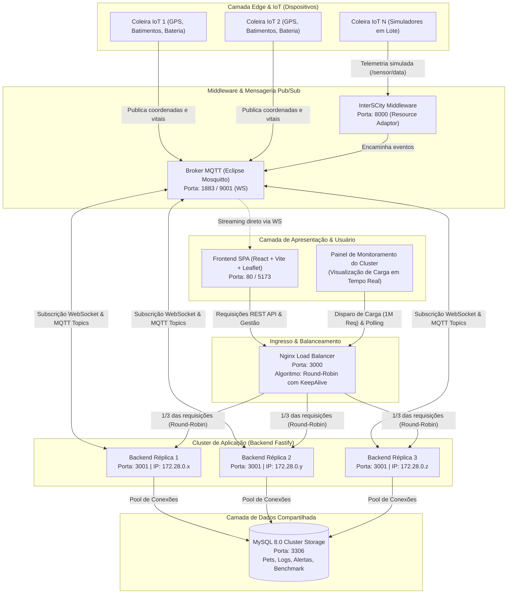
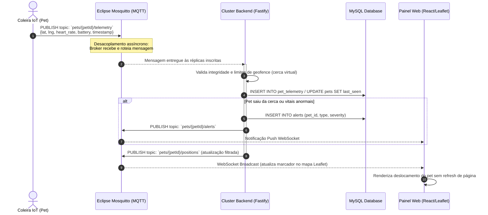
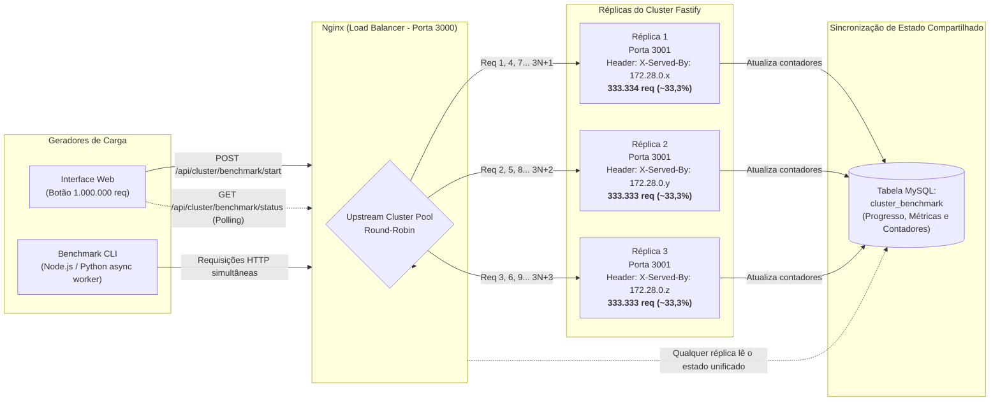
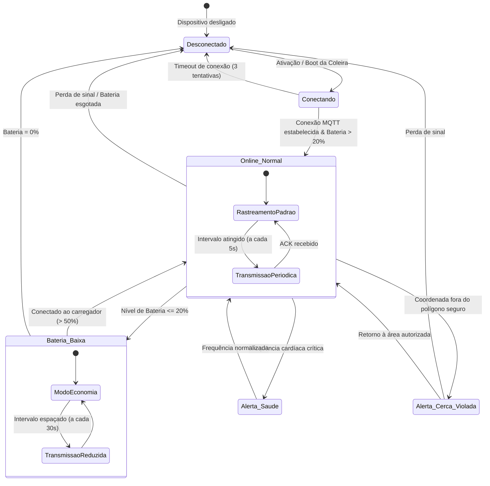
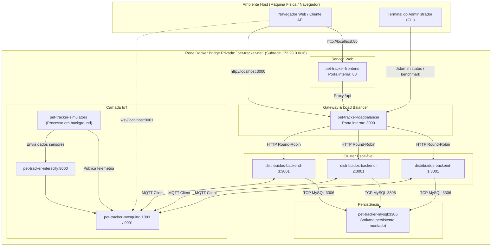

# 🗺️ Fluxogramas e Diagramas de Arquitetura — Pet Tracker Distribuído

> **Universidade Federal do Maranhão (UFMA)**  
> **Disciplina:** Sistemas Distribuídos  
> **Projeto:** Sistema Distribuído de Rastreamento de Pets em Tempo Real  
> **Autora:** Kauane  

Este documento apresenta a especificação visual e arquitetural completa do sistema, estruturada em diagramas **Mermaid**. O projeto demonstra conceitos fundamentais de computação distribuída: **escalabilidade horizontal, balanceamento de carga Round-Robin, tolerância a falhas, desacoplamento assíncrono via mensageria MQTT e consistência eventual de dados**.

---

## 📌 Sumário
1. [Visão Geral da Arquitetura End-to-End](#1-visão-geral-da-arquitetura-end-to-end)
2. [Fluxo de Ingestão de Telemetria e Notificação em Tempo Real](#2-fluxo-de-ingestão-de-telemetria-e-notificação-em-tempo-real)
3. [Topologia de Balanceamento de Carga e Teste de 1 Milhão de Requisições](#3-topologia-de-balanceamento-de-carga-e-teste-de-1-milhão-de-requisições)
4. [Ciclo de Vida e Máquina de Estados da Coleira IoT](#4-ciclo-de-vida-e-máquina-de-estados-da-coleira-iot)
5. [Topologia de Rede Docker e Isolamento](#5-topologia-de-rede-docker-e-isolamento)

---

## 1. Visão Geral da Arquitetura End-to-End

O diagrama abaixo descreve a interação entre as 4 camadas do sistema distribuído:
- **Camada Edge/IoT:** Dispositivos coleira e simuladores emulando telemetria em alta frequência.
- **Camada de Middleware & Ingestão:** InterSCity Platform e Broker Eclipse Mosquitto.
- **Camada de Aplicação & Cluster:** Nginx (Proxy Reverso / Load Balancer) distribuindo carga entre 3 réplicas Fastify (Node.js).
- **Camada de Persistência & Frontend:** Banco de Dados Relacional MySQL e Single Page Application React.

---

## 2. Fluxo de Ingestão de Telemetria e Notificação em Tempo Real

Este diagrama de sequência detalha o ciclo de vida de uma leitura de telemetria emitida por uma coleira até a sua persistência e exibição no mapa interativo:

---

## 3. Topologia de Balanceamento de Carga e Teste de 1 Milhão de Requisições

Demonstração do funcionamento do Nginx como ponto único de entrada (**Reverse Proxy / Load Balancer**) aplicando o algoritmo **Round-Robin** com pool de conexões persistentes (`keepalive 128`), permitindo a vazão de até 1.000.000 de requisições distribuídas homogeneamente:

---

## 4. Ciclo de Vida e Máquina de Estados da Coleira IoT

Cada dispositivo rastreador transita entre diferentes estados conforme as condições de conectividade, bateria e limites geográficos:

---

## 5. Topologia de Rede Docker e Isolamento

O ambiente é orquestrado através do Docker Compose com uma rede bridge isolada (`pet-tracker-net`), garantindo comunicação por DNS interno e expondo estritamente as portas necessárias ao host:

---

## 🔬 Conceitos de Sistemas Distribuídos Aplicados

| Conceito | Implementação Prática no Projeto |
| :--- | :--- |
| **Escalabilidade Horizontal** | O backend possui 3 instâncias equivalentes (`--scale backend=3`) que podem ser aumentadas dinamicamente sem interrupção de serviço. |
| **Balanceamento de Carga** | O Nginx distribui as requisições via algoritmo **Round-Robin**, inserindo nos cabeçalhos HTTP o metadado `X-Served-By` com o IP e porta da réplica que processou o payload. |
| **Desacoplamento Temporal e Espacial** | A comunicação entre coleiras IoT e o backend é assíncrona, mediada pelo Broker MQTT (Eclipse Mosquitto) no padrão Publish/Subscribe. |
| **Consistência Compartilhada** | O estado do teste de estresse de 1 milhão de requisições é unificado em uma tabela do MySQL (`cluster_benchmark`), garantindo que qualquer réplica consultada responda com o mesmo progresso em tempo real. |
| **Tolerância a Falhas** | Se uma réplica do backend for interrompida (`docker stop distribuidos-backend-2`), o Nginx redireciona as requisições para as réplicas remanescentes sem indisponibilidade para o usuário. |
