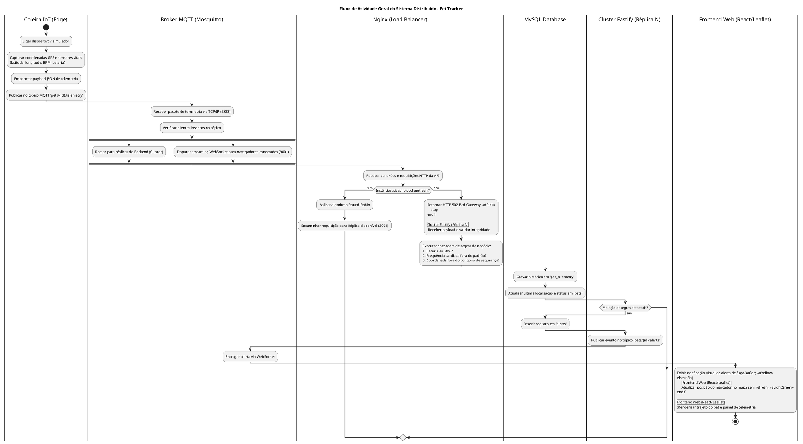
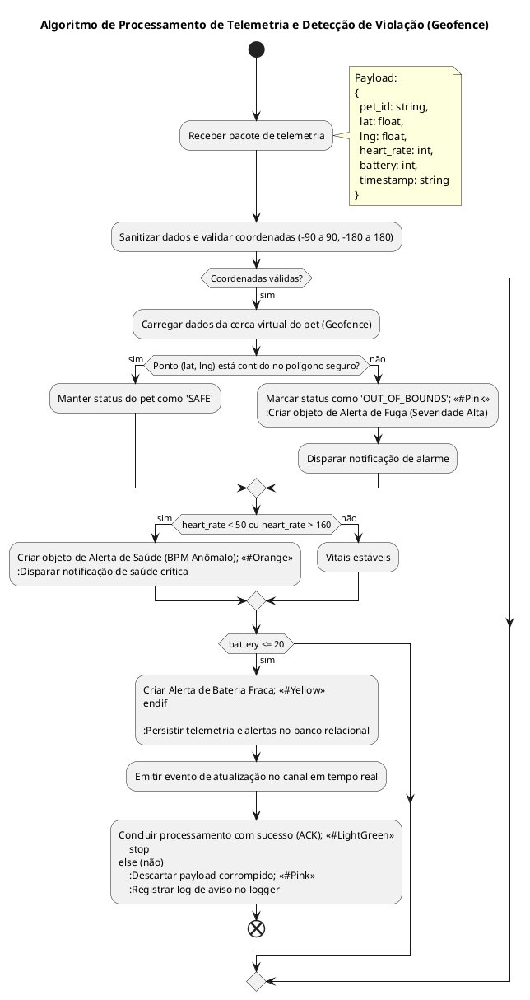
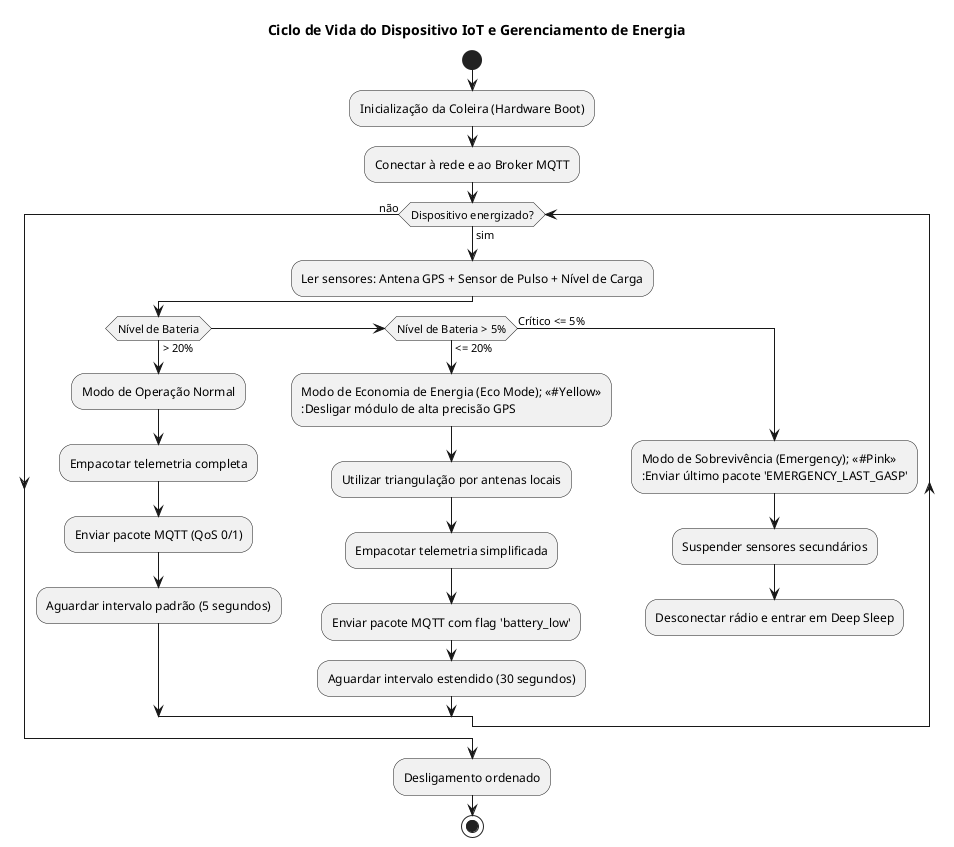
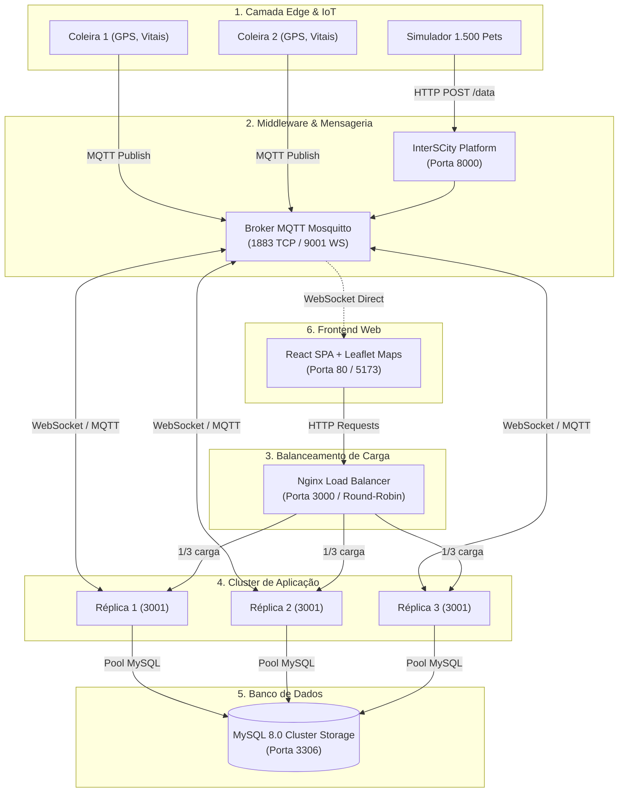
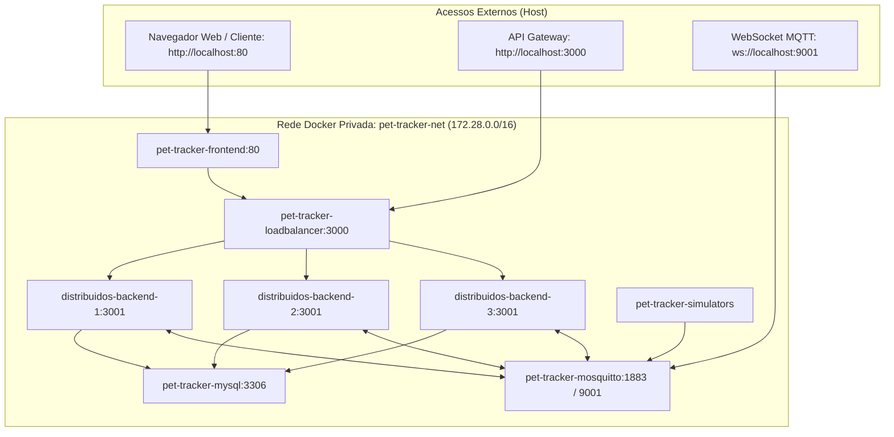

# 🗺️ Diagramas de Atividade e Arquitetura — Pet Tracker Distribuído

> **Universidade Federal do Maranhão (UFMA)**  
> **Disciplina:** Sistemas Distribuídos  
> **Projeto:** Sistema Distribuído de Rastreamento de Pets em Tempo Real  
> **Autora:** Kauane  
> **Padrão dos Diagramas:** [PlantUML Activity Diagram (Beta Syntax)](https://plantuml.com/activity-diagram-beta) + [Mermaid](https://mermaid.js.org/)

Este documento apresenta a especificação comportamental e arquitetural completa do sistema, estruturada através de **Diagramas de Atividade PlantUML (sintaxe nova / beta com swimlanes, condicionais, forks paralelos e repetições)** e diagramas **Mermaid**.

---

## 📌 Sumário
1. [PlantUML: Fluxo de Atividade Geral do Sistema (Swimlanes)](#-1-plantuml-fluxo-de-atividade-geral-do-sistema-com-swimlanes)
2. [PlantUML: Ingestão de Telemetria, Vitais e Cerca Virtual (Geofence)](#-2-plantuml-ingestão-de-telemetria-vitais-e-cerca-virtual)
3. [PlantUML: Balanceamento Round-Robin e Teste de 1 Milhão de Requisições](#-3-plantuml-balanceamento-round-robin-e-teste-de-1-milhão-de-requisições)
4. [PlantUML: Ciclo de Vida da Coleira IoT e Economia de Bateria](#-4-plantuml-ciclo-de-vida-da-coleira-iot-e-economia-de-bateria)
5. [Mermaid: Visão Geral da Arquitetura de Componentes](#-5-mermaid-visão-geral-da-arquitetura-de-componentes)
6. [Mermaid: Topologia de Rede Docker e Portas](#-6-mermaid-topologia-de-rede-docker-e-portas)

---

## 🚀 1. PlantUML: Fluxo de Atividade Geral do Sistema (com Swimlanes)

Este diagrama modela a sequência operacional de ponta a ponta, dividida nas raias (*swimlanes*) dos componentes distribuídos: **Coleira IoT**, **Broker MQTT**, **Load Balancer Nginx**, **Cluster Fastify**, **MySQL** e **Frontend Web**.



---

## ⚡ 2. PlantUML: Ingestão de Telemetria, Vitais e Cerca Virtual

Foco no algoritmo interno executado para cada medição, demonstrando decisões, ramificações e persistência condicional.



---

## ⚖️ 3. PlantUML: Balanceamento Round-Robin e Teste de 1 Milhão de Requisições

Demonstração do fluxo de estresse distribuído e da sincronização de contadores compartilhados através de conexões persistentes (*keep-alive*).

```plantuml
@startuml
title Fluxo de Balanceamento de Carga e Teste de Estresse de 1.000.000 de Requisições
skinparam defaultFontName sans-serif

start
:Usuário clica em 'Iniciar Teste de 1 Milhão' na Interface Web;
:Disparar POST /api/cluster/benchmark/start;

|Nginx Load Balancer|
:Receber requisição de início;
:Roteador encaminha para o Backend via Round-Robin;

|Cluster Backend Fastify|
:Inicializar registro de benchmark no MySQL:
- total_requests = 1.000.000
- completed_requests = 0
- status = 'RUNNING';

:Iniciar rotina assíncrona com pool HTTP Keep-Alive (128 conexões concorrentes);

repeat
    :Disparar lote de requisições HTTP para http://loadbalancer:3000/api/health;
    
    |Nginx Load Balancer|
    if (Índice da requisição) then (req % 3 == 1)
        :Encaminhar para Réplica 1 (172.28.0.x:3001);
        note right: Header HTTP: X-Served-By: 172.28.0.x
    elseif (req % 3 == 2)
        :Encaminhar para Réplica 2 (172.28.0.y:3001);
        note right: Header HTTP: X-Served-By: 172.28.0.y
    else (req % 3 == 0)
        :Encaminhar para Réplica 3 (172.28.0.z:3001);
        note right: Header HTTP: X-Served-By: 172.28.0.z
    endif
    
    |Cluster Backend Fastify|
    :Processar requisição e responder HTTP 200 OK;
    :Incrementar contadores da réplica correspondente;
    
    if (Lote atingiu 5.000 requisições?) then (sim)
        |MySQL Database|
        :Atualizar progresso na tabela 'cluster_benchmark';
        |Cluster Backend Fastify|
    endif

repeat while (completed_requests < 1.000.000?) is (sim) not (não)

|MySQL Database|
:Gravar status = 'FINISHED' e timestamp final;

|Frontend Web (React/Leaflet)|
:Polling em tempo real a cada 1s consulta /api/cluster/benchmark/status;
:Exibir 100% concluído com distribuição idêntica (~33,3% por réplica);
:Teste de 1 Milhão finalizado com sucesso; <<#LightGreen>>
stop
@enduml
```

---

## 🔋 4. PlantUML: Ciclo de Vida da Coleira IoT e Economia de Bateria

Representação do algoritmo de loop contínuo embarcado na coleira rastreadora.



---

## 🏛️ 5. Mermaid: Visão Geral da Arquitetura de Componentes

Para referência rápida e visualização gráfica imediata no GitHub:



---

## 🌐 6. Mermaid: Topologia de Rede Docker e Portas



---

## 📚 Como Renderizar os Diagramas PlantUML

Os diagramas acima utilizam a sintaxe oficial **PlantUML Activity Diagram (Beta)**. Para visualizá-los:
1. **Online:** Cole o código entre `@startuml` e `@enduml` no editor oficial: [PlantText Editor](https://www.planttext.com/) ou [PlantUML Server](http://www.plantuml.com/plantuml/uml/).
2. **VS Code / Antigravity:** Instale a extensão `PlantUML` (`jebbs.plantuml`) e pressione `Alt + D` com o cursor dentro do bloco.
3. **CLI:** Execute `plantuml FLUXOGRAMA.md` para exportar diretamente para PNG ou SVG.
